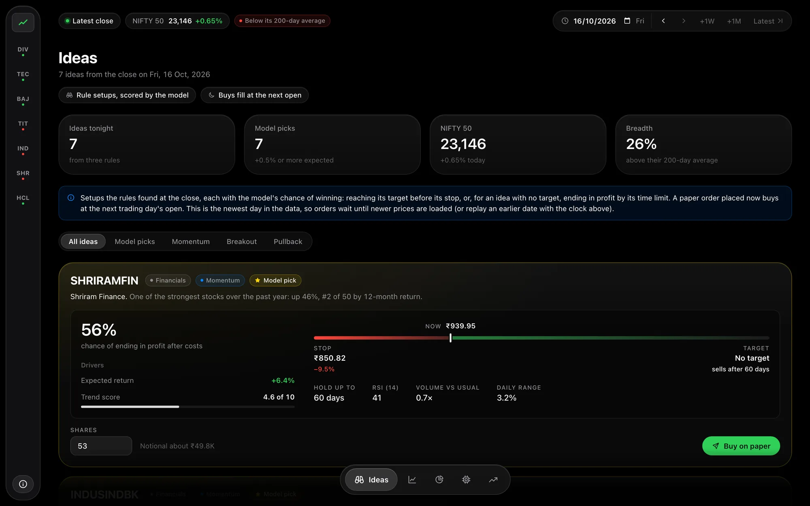
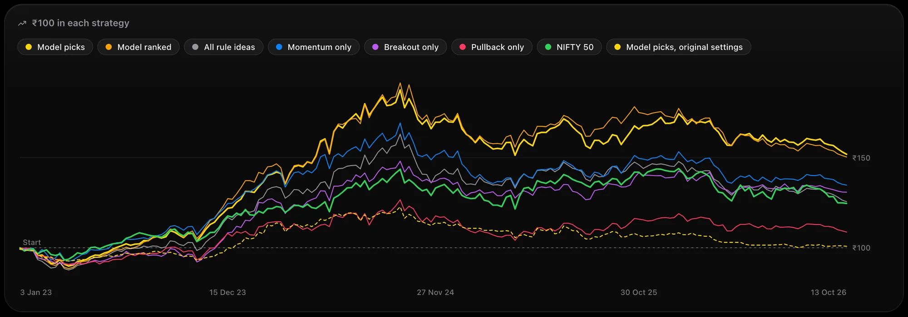
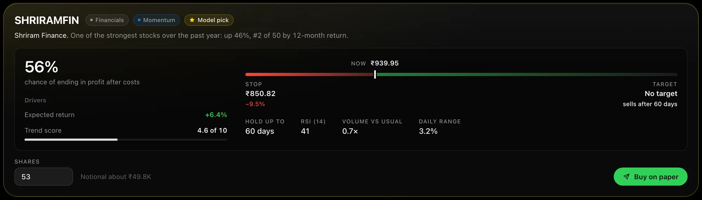
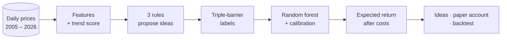
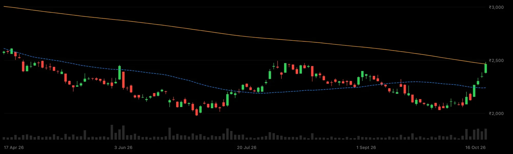
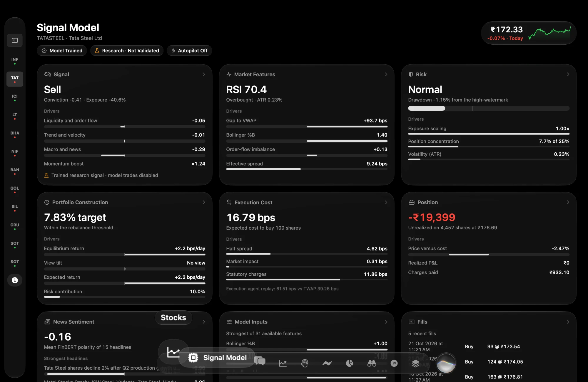

<div align="center">


# Stonks Lite

### A machine-learning swing-trade scout for NSE stocks

**Three rules find the setups. A calibrated model scores them. A paper account proves it.**<br/>
Replay any evening since 2006 and watch your trades play out, day by day.

<br/>


[**Quickstart**](#-run-it-in-60-seconds) · [**Results**](#-the-scoreboard) · [**How it works**](#-how-it-works) · [**The model**](#-the-model) · [**Profit levers**](#%EF%B8%8F-profit-levers) · [**Limitations**](#%EF%B8%8F-known-limitations)

<br/>



</div>

<br/>

## 📈 The scoreboard

**₹10 lakh, 3 Jan 2023 → 13 Oct 2026**, on test years the model never trained on. Ten equal slots, 0.15% costs each way.

<div align="center">

| | 🟡 **Model picks** | 🟢 NIFTY 50, buy and hold |
|:--|:--:|:--:|
| **₹10 lakh became** | **₹15.24 lakh** | ₹12.69 lakh |
| **Total return** | **+52.4%** | +26.9% |
| **Per year** | **+11.8%** | +6.5% |
| **Sharpe ratio** | **0.85** | 0.57 |
| **Worst fall** | −20.1% | **−15.8%** |
| **Trades · won · average** | 257 · 47% · +2.07% | n/a |



</div>

> [!WARNING]
> **Read this before the number above.** Every setting was chosen on 2006–2021, but the 2023–2026 test years
> had been looked at once *before* the profit levers were searched for. The 50 stocks are today's large
> companies, which flatters long holds with wide stops most. Treat +52.4% as optimistic, not proven.
> [Full details below](#-results-in-full-test-years-20232026).

<br/>

## ✨ What's inside

<table>
<tr>
<td width="50%" valign="top">

### 🔭 Three classic setups, every evening
**Momentum** (top 10% by 12-month return), **breakout** (a 55-day high on 1.5× volume) and **pullback**
(a sharp two-day dip above the 200-day average) scan all 50 stocks after the close.

</td>
<td width="50%" valign="top">

### 🧠 A model that knows what 56% means
A random forest, chosen by walk-forward cross-validation and calibrated with Platt scaling, so *56%*
means about 56 in 100 trades like it won. The chance becomes an **expected return after costs**.

</td>
</tr>
<tr>
<td width="50%" valign="top">

### ⏪ A replay clock for the whole app
Set any evening since 2006. Every page, chart and idea is rebuilt *as of* that close. Nothing from the
future can leak in. Step forward a day, a week or a month and watch orders fill.

</td>
<td width="50%" valign="top">

### 📄 A paper account with real rules
Orders fill at the next open, then exit at the stop, the target or the time limit. They use the same rules
as the training labels, so the paper account tests what the model learned. SQLite-backed, ₹10 lakh start.

</td>
</tr>
<tr>
<td width="50%" valign="top">

### 🎛️ Four profit levers, tuned honestly
Per-rule exits, a model-ranked strategy, a NIFTY 200-day regime filter and an idle-cash sweep. Chosen by
walk-forward evaluation on 2006–2021 only, with every variant published.

</td>
<td width="50%" valign="top">

### 🧾 Brokerage and taxes, itemised
The Backtest page reprices every trade at NSE delivery rates on its own date (STT, exchange charge, SEBI
fee, stamp duty, GST, brokerage) and shows the gap to the flat 0.15% as a slippage allowance.

</td>
</tr>
</table>

<div align="center">

<sub>A momentum idea: no target, a 3 × ATR stop, and up to 60 days to run. The ladder fades out on the right because the upside is open-ended.</sub>
</div>

<br/>

## 🚀 Run it in 60 seconds

You need **Python 3.10+**. Node.js 20+ is only needed if you want to change the frontend.

```bash
git clone https://github.com/PranavAshokkumar/Stonks_Lite.git
cd Stonks_Lite

python3 -m venv .venv && source .venv/bin/activate      # Windows: .venv\Scripts\activate
pip install -r requirements.txt

python -m backend.app                                   # → http://127.0.0.1:5050
```

That's it. A trained model is already in `artifacts/`, and `frontend/dist/` holds a pre-built copy of the web
app that Flask serves by itself.

<details>
<summary><b>Develop the frontend, retrain, run the tests, update prices</b></summary>

<br/>

**Frontend with hot reload** (in a second terminal, with the API server still running):

```bash
cd frontend
npm install
npm run dev                          # → http://localhost:5173, proxies /api to Flask
npm run build                        # rebuild frontend/dist after changing React code
```

**Retrain everything** (about a minute; rewrites `artifacts/`):

```bash
python -m backend.pipeline
```

**Tests** (25 of them): the indicators, the trade labels and the rules. They also show that the paper broker
and the labels agree on 300 random price paths, and that the real paper broker closes every trade where its
label says. Every API endpoint is called.

```bash
python -m unittest discover tests -v          # or: pytest
```

**Re-choose the profit levers.** This re-runs the walk-forward evaluation on 2006–2021 and rewrites `artifacts/trials.csv`:

```bash
python -m backend.tune
```

**Newer prices** (needs internet). This updater was written offline and hasn't been run against Yahoo yet,
so check its output the first time:

```bash
pip install yfinance
python -m backend.update_data                 # then restart the server
```

</details>

<br/>

## 🧬 How it works



**Every trade gets its own exits** (`config.RULE_EXITS`). The entry is always the next day's open:

| Rule | Fires when | Target | Stop | Time limit | A win means |
|:--|:--|:--:|:--:|:--:|:--|
| 🔵 **Momentum** | Top 10% of stocks by 12-month return (skipping the last month) | none | 3 × ATR | 60 days | ends in profit after costs |
| 🟣 **Breakout** | Closes at a 55-day high on ≥ 1.5× the last 20 days' volume | none | 3 × ATR | 60 days | ends in profit after costs |
| 🔴 **Pullback** | 2-day RSI under 10 while above the 200-day average | 4 × ATR | 2 × ATR | 20 days | hits the target before the stop |

<details>
<summary><b>The pipeline, step by step</b></summary>

<br/>

1. **Data.** Daily open, high, low, close and volume for 50 large NSE companies and the NIFTY 50 index, from
   January 2005 to 16 October 2026 (`data/`). The prices are split- and bonus-adjusted and were exported
   from the original app's store.
2. **Features** (`backend/indicators.py`): returns over 1 week to 1 year, 12-month momentum, distance from
   the 20/50/200-day averages and the 52-week high, RSI(14), RSI(2), ATR, volume measures, market breadth
   and the NIFTY's trend. Each row uses that day and earlier only, and a test checks this.
3. **Rules** (`backend/rules.py`): the three setups above. An idea that several rules propose follows the
   first of momentum, breakout and pullback.
4. **Labels** (`backend/labels.py`): the triple-barrier method. A day that touches both barriers counts as a
   stop. A gap through a barrier fills at the open. Costs are 0.15% each way.
5. **Model** (`backend/model.py`):
   - **Time-based split, never random:** train 2006–2021 (33,173 ideas), validate 2022 (1,811), test
     2023–2026 (8,311). Ideas whose trade crossed a boundary are dropped from the earlier set ("purging").
   - **Three classifiers** compared by walk-forward cross-validation: fit on the years before, score the
     next year, for 2014–2021. The random forest won.
   - **Platt scaling** on 18,843 out-of-sample predictions makes the probabilities honest.
   - **Expected return** = P(win) × a winner's gain + (1 − P(win)) × a non-winner's typical loss, after
     costs. A winner's gain is the target or, with no target, the average winner's gain (about 2 × its stop).
     A non-winner typically loses 0.92 × its stop for momentum, 0.94 for breakout and 0.33 for pullback.
     All of these are measured per rule on the training years. An idea with at least +0.5% is a **model pick**.
6. **Trend score** (`backend/score.py`): 30% trend, 25% momentum, 20% relative strength, 15% nearness to the
   52-week high and 10% volume. Each part is scaled 0–1, summed and multiplied by 10, with no training. A
   score of 7 or more is bullish. A *Trend Start* is the score reaching 7; a *Trend End* is it falling under 5.
7. **Backtest** (`backend/backtest.py`): each strategy runs a 10-slot paper account over the test years with
   the same entry, exit and cost rules. New positions are half size when the NIFTY closed under its 200-day
   average on the signal day.
8. **Paper trading** (`backend/portfolio.py`): SQLite-backed and replayed one day at a time. Each trade keeps
   its rule's own exits. The suggested quantity is halved in the same falling-market condition.

</details>

<br/>

## 🧠 The model

**Do higher chances really mean more wins?** These are the test ideas, sorted into five equal groups by the
model's chance:

```text
Least confident  ███████                17.8% won    +0.13% a trade
Second fifth     ██████████▏            25.5% won    −0.09% a trade
Middle fifth     ████████████████▌      41.4% won    +2.32% a trade
Fourth fifth     ███████████████████▌   49.0% won    +3.54% a trade
Most confident   ████████████████████▍  51.0% won    +4.02% a trade
```

<table>
<tr>
<td width="58%" valign="top">

| Model | Walk-forward AUC<br/>2014–21 | 2022 AUC | Test AUC |
|:--|:--:|:--:|:--:|
| Logistic Regression | 0.617 ± 0.022 | 0.612 | 0.664 |
| **Random Forest** ✅ | 0.627 ± 0.023 | 0.619 | **0.660** |
| Gradient Boosting | 0.617 ± 0.032 | 0.625 | 0.649 |

The choice used **only** the walk-forward column. The test column is shown for transparency.

**Brier score** 0.2177, against 0.2341 for always guessing the average.

</td>
<td width="42%" valign="top">

**Does 45% really mean 45%?** The test ideas are split into eight groups of about 1,039 each:

| Model said | Actually won |
|:--:|:--:|
| 20.9% | 18.2% |
| 24.1% | 18.6% |
| 35.6% | 27.2% |
| 42.5% | 36.0% |
| 43.8% | 44.6% |
| 45.0% | 45.1% |
| 46.9% | 56.2% |
| 52.3% | 49.6% |

It is close in the middle and a little optimistic at the low end.

</td>
</tr>
</table>

> [!NOTE]
> **Part of that AUC is not skill.** The label means different things for different rules: a pullback must
> reach its target, while momentum and breakout only need a profit. So the rule flags alone separate many
> winners from losers, and the top feature is `is_momentum` (the volume trend, the pullback flag and market breadth follow). These
> AUCs can't be compared with the original labels' (0.590 test for logistic regression). The +0.5% pick filter
> is now loose too: it passes 7,277 of 8,311 test ideas. Most of the gap between *Model picks* and *All rule
> ideas* comes from which ideas fill the slots first.

<br/>

## 🎛️ Profit levers

Four switches in `backend/config.py`. Set any of them to `None` and you get the original behaviour back
exactly. This was checked on the training years: identical labels, expected-return inputs and account curves.

| Switch | What it does | Chosen |
|:--|:--|:--|
| `RULE_EXITS` | Each rule's own target (or none), stop and time limit, used by the labels, the expected return, the backtest and the paper account | Momentum and breakout: no target, 3 × ATR stop, 60 days. Pullback: 4 × / 2 × ATR, 20 days |
| `MODEL_RANKED` | Adds a *Model ranked* strategy: every idea goes into free slots, best `p_win` or `expected_return` first | `expected_return` |
| `REGIME` | When the NIFTY is under its 200-day average, `half` the size of new positions or `skip` them | `half` |
| `CASH_SWEEP` | Idle cash earns a liquid fund's 6% or tracks the NIFTY. It shows as its own `cash_earned` line, never in a trade's P&L | off |

**How they were chosen** (`python -m backend.tune` → `artifacts/trials.csv`). Only 2006–2021 was used. Every
variant ran a 10-slot account over 2014–2021. Where the model was involved, each year's ideas were scored by
a model fitted only on ideas that finished before that year. The procedure was fixed before the first run:
exits first (one rule at a time), then filtering or ranking with the model, then the regime filter, then idle
cash. At each stage the current setting stayed unless a variant beat it by **at least 0.05 Sharpe**. That
margin is why the liquid fund (+0.04) is off.

<details>
<summary><b>All 18 variants, every one published</b></summary>

<br/>

✅ = kept at its stage. Exits are target ATRs / stop ATRs / max days. M, B and P are momentum, breakout and pullback.

| # | Stage | Variant | Settings | CAGR | Sharpe | Max fall |
|---|---|---|---|---|---|---|
|  | ref | NIFTY 50 buy and hold |  | +13.5% | 0.84 | −38.4% |
| 1 | 0 | Model picks, original settings | exits all 4/2/20; regime off; cash idle | +7.8% | 0.54 | −24.9% |
| 2 | 1 | Momentum only, exits 4/2/20 | exits all 4/2/20 | +8.0% | 0.62 | −27.6% |
| 3 | 1 | Momentum only, exits none/3/40 | exits all none/3/40 | +16.0% | 1.01 | −30.0% |
| 4 | 1 | **Momentum only, exits none/3/60** ✅ | exits all none/3/60 | +17.8% | 1.08 | −30.5% |
| 5 | 1 | Breakout only, exits 4/2/20 | exits all 4/2/20 | +6.3% | 0.58 | −19.7% |
| 6 | 1 | Breakout only, exits none/3/40 | exits all none/3/40 | +7.7% | 0.60 | −25.4% |
| 7 | 1 | **Breakout only, exits none/3/60** ✅ | exits all none/3/60 | +10.0% | 0.73 | −23.3% |
| 8 | 1 | **Pullback only, exits 4/2/20** ✅ | exits all 4/2/20 | +7.6% | 0.59 | −26.1% |
| 9 | 1 | Pullback only, exits 2/2/5 | exits all 2/2/5 | −2.1% | −0.12 | −38.5% |
| 10 | 1 | Pullback only, exits none/2/5 | exits all none/2/5 | −3.3% | −0.22 | −43.5% |
| 11 | 2 | **Model picks** ✅ | exits M,B none/3/60, P 4/2/20; regime off; cash idle | +26.9% | 1.37 | −35.4% |
| 12 | 2 | Model ranked by p_win | same | +23.1% | 1.22 | −33.6% |
| 13 | 2 | Model ranked by expected_return | same | +24.9% | 1.26 | −35.9% |
| 14 | 2 | All rule ideas | same | +19.6% | 1.10 | −34.6% |
| 15 | 3 | **Model picks, regime half** ✅ | exits as above; regime half; cash idle | +25.4% | 1.45 | −24.9% |
| 16 | 3 | Model picks, regime skip | exits as above; regime skip; cash idle | +21.1% | 1.26 | −23.2% |
| 17 | 4 | Model picks, cash liquid fund 6% | exits as above; regime half; cash liquid | +26.3% | 1.49 | −24.8% |
| 18 | 4 | Model picks, cash tracks NIFTY | exits as above; regime half; cash nifty | +27.7% | 1.35 | −38.8% |

The stage 1 rows ran with no model, no regime filter and idle cash. The pullback rule kept its old exits: the
5-day versions suggested by a trade-level diagnostic lost money once a 10-slot account paid costs on twice as
many trades. Before this, that one-off diagnostic looked at 36 trade-level exit variants and 17 account
variants on the same years. That makes **71 looks at 2006–2021 in all**.

</details>

<br/>

## 📊 Results in full (test years 2023–2026)

**The test years have been viewed before.** The original settings were run on 2023–2026 first (the
*before* column), and the levers were searched for *because* those results were poor. The levers were then
chosen on 2006–2021 only, frozen, and the pipeline was run once on the test years.

| Strategy | Before: total | per year | worst fall | Sharpe | **After: total** | **per year** | **worst fall** | **Sharpe** |
|:--|--:|--:|--:|--:|--:|--:|--:|--:|
| 🟢 NIFTY 50 (buy and hold) | +26.9% | +6.5% | −15.8% | 0.57 | +26.9% | +6.5% | −15.8% | 0.57 |
| 🟡 **Model picks** | +0.9% | +0.2% | −18.4% | 0.07 | **+52.4%** | **+11.8%** | −20.1% | **0.85** |
| 🟠 Model ranked *(new)* | | | | | +50.9% | +11.5% | −22.5% | 0.83 |
| ⚪ All rule ideas | −1.5% | −0.4% | −28.3% | 0.05 | +25.7% | +6.2% | −23.9% | 0.53 |
| 🔵 Momentum only | +17.6% | +4.4% | −21.8% | 0.42 | +34.6% | +8.2% | −21.2% | 0.65 |
| 🟣 Breakout only | −2.0% | −0.5% | −26.0% | 0.00 | +31.5% | +7.5% | −14.5% | 0.70 |
| 🔴 Pullback only | −19.5% | −5.6% | −26.3% | −0.41 | +8.6% | +2.2% | −17.8% | 0.25 |

*Model picks after:* 257 trades, 47% won, +2.07% a trade, 83% invested on average (before: 356 trades, 43%,
+0.07%, 44% invested). **Costs:** the backtest charged ₹90,243 at the flat 0.15%. NSE's actual delivery charges
on those 514 orders come to ₹66,889 (₹60,162 of it STT), so the remaining ₹23,354 is a cushion for slippage.

**Conclusion.** Most of the gain comes from **letting momentum and breakout trades run**: no target, a wider stop,
60 days. The drop from the tuning window (Sharpe 1.45 there, 0.85 here) is a reminder that 18 variants chosen on
one history overfit somewhat. Survivorship bias favours exactly these wide-stop, long-hold exits. So read this
as *"the swing rules may have an edge once trades are allowed to run"*, not as a proven one. A fair check would
be new data from after October 2026, or a universe that includes the stocks that fell out of the index.

<br/>

## 🖥️ The pages

<div align="center">

<sub>Hand-written SVG candlesticks, 50- and 200-day averages, and volume. No chart library.</sub>
</div>

<br/>

| Page | What it shows |
|:--|:--|
| **Home** `#/` | What Stonks Lite is for, its live research record, the Stonks apps for Mac and Android, and Lite against Pro pricing |
| **Ideas** | Tonight's rule ideas as trade tickets: why the rule fired, the price ladder, the model's chance, the expected return, and a paper buy box. Model picks get a ⭐ |
| **Stocks** | All 50 stocks with price changes, RSI and the 0–10 trend score. Sort, search and filter by sector |
| **Stock detail** | Candles with 50/200-day averages and Trend Start/End markers, trend score and RSI over time, and the stock's past ideas with their outcomes |
| **Paper account** | Cash, holdings, orders waiting for the next open, closed trades, idle-cash income and the account's value over time |
| **Model** | The ML pipeline step by step, the model comparison, win rate by confidence, the calibration chart, the ROC curve and feature importance |
| **Backtest** | Every strategy against the NIFTY 50, with the NIFTY's falls of 7% or more shaded, a card per rise and fall, the lever settings, and itemised NSE charges |
| **How it works** | A plain-language explanation and a glossary |

The **clock bar** sets the evening the whole app looks at. Moving it forward replays the days in between:
orders fill at the next open, and trades hit their target, their stop or their time limit. Moving it back
resets the paper account. No page ever shows data from after the clock's date.

<br/>

## 🏗️ Under the hood

<details>
<summary><b>Project layout</b></summary>

<br/>

```text
Stonks_Lite/
├── backend/
│   ├── config.py          every tunable number: rules, barriers, levers, split dates, costs
│   ├── data.py            loads the CSVs
│   ├── indicators.py      feature engineering, per stock and across stocks
│   ├── rules.py           the three rules and the plain-English reason for each idea
│   ├── labels.py          triple-barrier labels and expected return
│   ├── score.py           the 0–10 trend score and Trend Start/End events
│   ├── model.py           split, walk-forward CV, calibration, evaluation
│   ├── backtest.py        paper-account simulation of each strategy
│   ├── charges.py         brokerage and taxes on a delivery trade, at NSE's rates on its date
│   ├── pipeline.py        runs all of it and writes artifacts/       python -m backend.pipeline
│   ├── tune.py            walk-forward choice of the profit levers    python -m backend.tune
│   ├── market.py          everything the API asks, "as of" a date
│   ├── portfolio.py       paper trading on SQLite, with the replay clock
│   ├── app.py             Flask REST API                              python -m backend.app
│   └── update_data.py     optional price update from Yahoo Finance
├── artifacts/             model.joblib · metrics.json · backtest.json · trials.csv · backtest_before.json
├── data/                  stocks.csv · nifty50.csv · prices/<SYMBOL>.csv
├── frontend/              React + Vite: src/pages, src/components, src/lib.js, src/styles.css
└── tests/                 unit and API tests
```

</details>

<details>
<summary><b>REST API</b></summary>

<br/>

| Method and path | Returns |
|:--|:--|
| `GET /api/status` | The clock's date, the NIFTY's trend, counts, model info |
| `GET /api/ideas` | The evening's ideas with chance, expected return, stop, target and time limit |
| `GET /api/stocks` | All 50 stocks with indicators and trend score |
| `GET /api/stocks/<symbol>?days=365` | One stock's history, score parts, events and past ideas |
| `GET /api/model` · `GET /api/backtest` | The training and backtest reports |
| `GET /api/portfolio` | The paper account, including `cash_earned` |
| `POST /api/portfolio/orders` `{symbol, qty}` | A paper buy at the next open |
| `POST /api/portfolio/<id>/close` | Sell at today's close, or cancel a waiting order |
| `POST /api/portfolio/reset` | Back to ₹10,00,000 cash |
| `POST /api/clock` `{date}` / `{step}` / `{latest: true}` | Move the replay clock |
| `POST /api/waitlist` `{email, platform, source}` | Join the Pro waitlist (stored in `paper_trading.db`) |

</details>

<details>
<summary><b>The big sibling: TARGET20 / Stonks for Mac</b></summary>

<br/>

Stonks Lite is a smaller, web-based version of **TARGET20 / Stonks**, a macOS (SwiftUI) app with a large
Python backend. The core idea stays the same: rules propose trades, a calibrated model judges them, and
everything is tested honestly on paper. Everything else was cut.



| TARGET20 (original) | Stonks Lite |
|:--|:--|
| macOS SwiftUI app (10 pages) | React web app |
| FastAPI backend with WebSocket streams | Flask REST API |
| Every NSE stock via the Upstox broker API, live quotes, minute bars | 50 large caps, daily bars from CSV files |
| Swing rules v1–v4 with LightGBM meta-labeling and isotonic calibration | The same three rules and labels; scikit-learn with walk-forward CV and Platt calibration |
| Research gate: CPCV, deflated Sharpe, permutation null, trial ledger | One time split, walk-forward validation, a held-out test period |
| Trend score v4 (technical 60% + fundamental checklist 40%, cap tiers) | The technical part only |
| Paper broker with minute fills, OPG orders, kill switch, rate caps | Next-open fills on daily bars, stop/target/time-limit exits per rule |
| MARL/PPO/IQN reinforcement-learning agents, Black-Litterman and convex optimisers, the F&O system, FinBERT news sentiment, fundamentals and AMFI cap tiers, the v3 monthly momentum book, launchd scheduling | **Removed** |

</details>

<br/>

## ⚠️ Known limitations

- **Survivorship bias.** The 50 stocks are today's large companies, so the history leaves out companies that
  shrank or failed. This flatters every backtest, and the chosen exits most of all: a wide stop, no target and a
  60-day hold ride out dips in stocks we already know recovered, while the stocks whose dips kept going (and
  later left the index) aren't in the data.
- **Many looks at the same history.** 18 lever variants plus 53 in an earlier diagnostic, all on 2006–2021.
  The 2023–2026 test years were viewed once before the levers and once after. No correction for this many
  trials (such as a deflated Sharpe ratio) has been made.
- **The Sharpe ratio doesn't subtract a risk-free rate**, so a cash sweep into a liquid fund raises it without
  any extra skill.
- **Daily bars** can't show whether the stop or the target came first on a day that touched both. Such days
  count as a stop.
- **Costs** are a flat 0.15% each way in the backtest. Real costs depend on the broker and the order size.
- **Fills** happen at the next open on daily data. There is no intraday simulation.

<br/>

## 📚 References

- M. López de Prado, *Advances in Financial Machine Learning* (2018): triple-barrier labels (ch. 3),
  meta-labeling (§3.6), purging (ch. 7).
- N. Jegadeesh and S. Titman, "Returns to buying winners and selling losers: implications for stock market
  efficiency", *Journal of Finance* (1993): momentum.
- J. Platt, "Probabilistic outputs for support vector machines" (1999); A. Niculescu-Mizil and R. Caruana,
  "Predicting good probabilities with supervised learning", ICML (2005): calibration.
- J. W. Wilder, *New Concepts in Technical Trading Systems* (1978): RSI and ATR.

<br/>

<div align="center">

---

**Coursework, not investment advice. Every rupee here is pretend: no real order is ever placed.**

<sub>Built with pandas, scikit-learn, Flask, SQLite, React and a lot of hand-drawn SVG.</sub>

</div>
